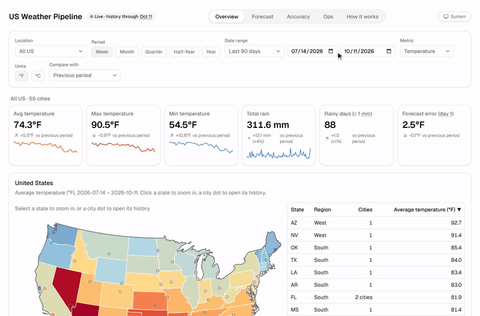
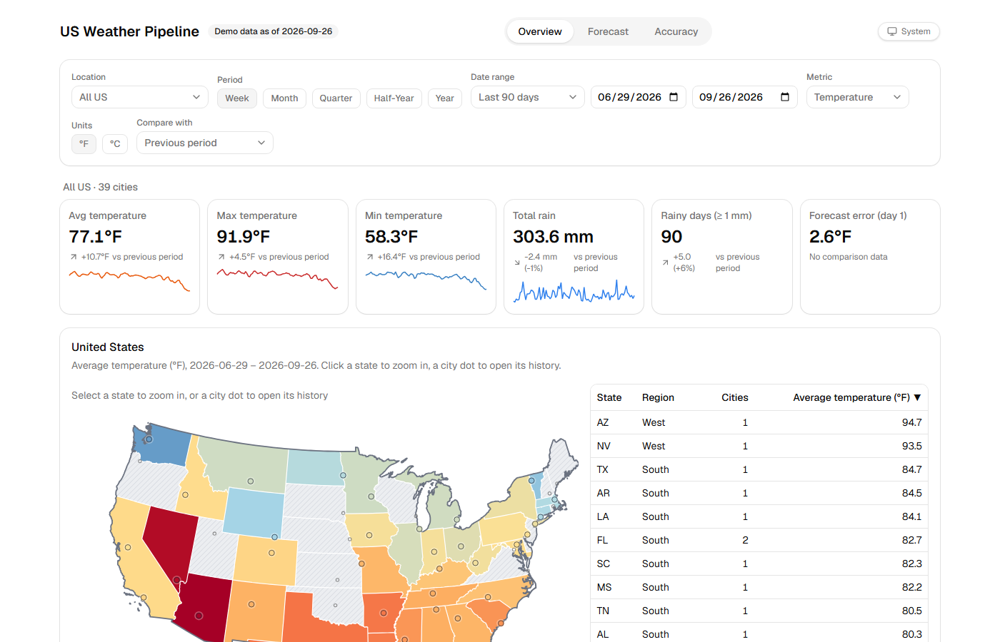
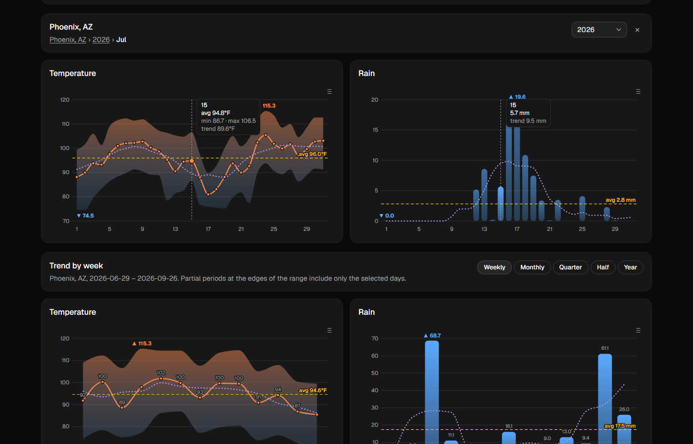
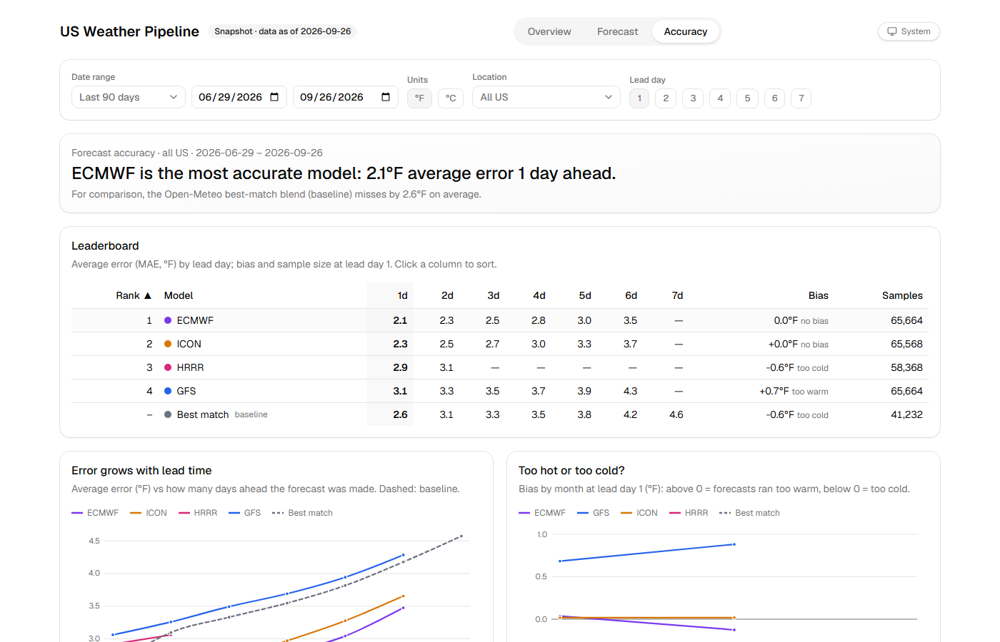
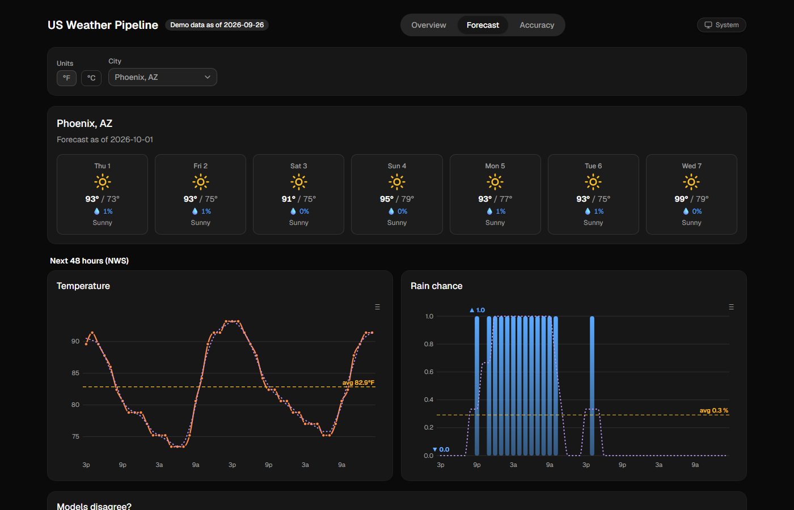
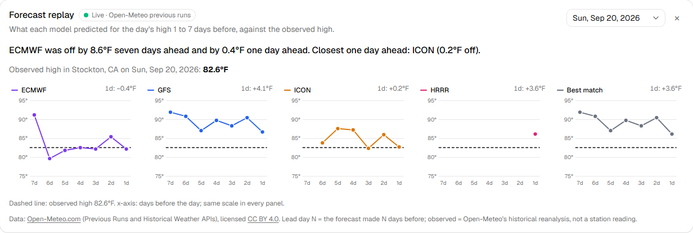
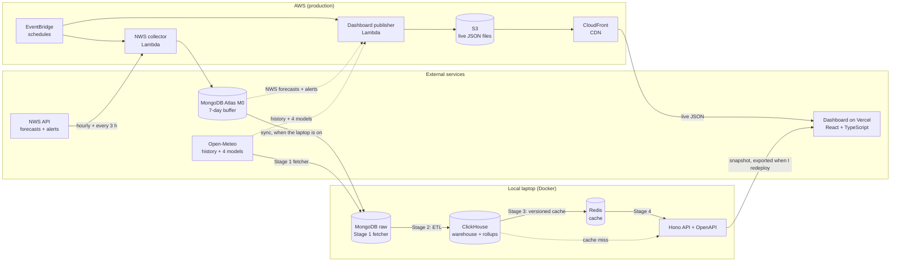
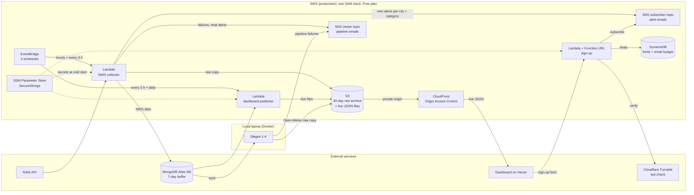

# US Weather Pipeline

**Which weather model forecasts the US best? An end-to-end data pipeline and dashboard that collects forecasts from 5 models, scores them against what actually happened, and explains 3 years of weather for 53 US cities, on a $0 budget.**

[](https://github.com/dangkhoa241/us-weather-pipeline/actions/workflows/ci.yml)

[](LICENSE)
[](https://us-weather-pipeline.vercel.app)

### ▶ [Live demo: us-weather-pipeline.vercel.app](https://us-weather-pipeline.vercel.app)

The demo updates itself from AWS (badge "Live · history through …"; the Forecast and Accuracy pages show when the forecast was updated and the last scored day): a scheduled Lambda publishes recent history, forecasts
and alerts to S3 behind CloudFront (Part 4). If CloudFront is unreachable, it falls back to the bundled snapshot
("Snapshot · history through …").



## Key finding

> **ECMWF is the most accurate model: 2.0 °F average error one day ahead** (as of 2026-10-09).

| Model (lead day 1) | Average error | Bias |
|---|---|---|
| 🥇 ECMWF | **2.0 °F** | none |
| 🥈 ICON | 2.2 °F | none |
| 🥉 HRRR | 2.8 °F | 0.5 °F too cold |
| GFS | 3.0 °F | 0.9 °F too warm |
| *Best-match blend (baseline)* | *2.5 °F* | *none* |
| NWS | not ranked yet | scored on 11 days so far |

As of 2026-10-09: error grows by about 0.28 °F for each extra day of lead time. The scores compare hourly forecasts with observed temperatures: about 55,000 pairs per model on 33–36 scored days, from 53 cities, 2026-07-12 to 2026-10-09. A model is ranked only after 30 days of scores. NWS has 11 so far: on the 3,222 city-hours both were scored on, ECMWF missed by 1.58 °F and NWS by 1.93 °F. Method: [How this is measured](#how-accuracy-is-measured).

## Design decisions

I designed the product and its features. Claude Code implemented them under my direction: for each key feature it
built 3 implementations, and I compared them with measured numbers before merging the winner. The strongest decisions:

- **$0 and hybrid by design:** NWS data is collected on AWS (Lambda + EventBridge) into a 7-day Atlas buffer, so the
  laptop can be off; the warehouse, cache and API run in Docker on the laptop. The collector uses ~2% of Lambda's free tier.
- **Static files for the public site:** a publisher Lambda writes JSON to S3 behind CloudFront. Small attack surface:
  no code runs per page view.
- **Measured, not guessed:** Redis cache warm p95 35.4 → 2.9 ms; Hono over Express and Fastify (~150 MB vs up to
  282 MB peak memory); a hand-rolled d3 map at +47 KB vs +71 / +83 KB.
- **Alert emails only on a real change:** a replay of the stored heat alerts sends 5 emails instead of 17, with a hard
  cap of 900 subscriber emails a month.

All 10 decisions, with the alternatives, trade-offs and the source of every number:
[docs/DESIGN_DECISIONS.md](docs/DESIGN_DECISIONS.md). Product choices (city drill-down, linked map and state table, twin
charts, period filters, one city per state) are under [Features](#features).

## Features

| | |
|---|---|
|  |  |
| **Overview:** a map with 53 city dots and a linked, sortable state table, below All US KPIs compared with the previous period. | **City history (dark mode):** years → months → days, twin charts with a synced crosshair, and PNG/CSV download. |
|  |  |
| **Accuracy:** the leaderboard by lead day, error vs lead time, bias by month, the best model per state and the biggest misses. | **Forecast:** 7-day NWS cards, the next 48 hours, a "Models disagree?" spread chart and active NWS alerts. |

Also included:
- **Email alert sign-ups:** pick a city and alert types (heat, flood, wind/storm, winter, fire & air quality, tropical) and confirm by email; design and limits in [docs/analysis/email-signups.md](docs/analysis/email-signups.md).
- **Pipeline Ops page** (`/ops`): is the pipeline healthy right now? Last run, status and duration of each Lambda job, data freshness, incidents and alert-email counts of the last 7 days, from a sanitized `status.json` the publisher writes every 3 hours (bundled fallback when offline); see [docs/analysis/pipeline-ops.md](docs/analysis/pipeline-ops.md).
- **How it works page** (`/how-it-works`): the whole project in one interactive diagram, with a *Data flow* view (sources → collectors → MongoDB → ClickHouse → Redis → API → this site) and an *AWS* view (schedules, serverless functions, S3, CloudFront, SNS, sign-ups). Lanes and border patterns show where each part runs (external service, AWS, local laptop). Click or press Enter on any part for what it does, why it was chosen and one measured number with its source. Live "last run" badges come from `status.json`, the page respects reduced motion, and a plain-text summary sits under the diagram.
- Every filter is in the URL, so links can be shared and Back/Forward work.
- Keyboard-accessible map and charts.
- Light and dark themes that follow the system.
- Missing data always shows as a gap, never as 0.
- Every abbreviation and weather term (ECMWF, MAE, lead day, spread, …) has a tooltip with its full name and a one-line explanation, from one glossary file.

### Forecast replay



In a city's day view, **Replay forecasts** shows what ECMWF, GFS, ICON, HRRR and best match predicted for that day's
high 1 to 7 days before, against the observed high, with a plain-words summary line.
- **Live from the browser:** it calls Open-Meteo's Previous Runs and archive APIs directly, with no backend, Docker
  or AWS. Each day shown costs 2 requests, and each day is fetched once per page load.
- **Fallback:** if Open-Meteo can't be reached, it says "Live data unavailable" and shows a bundled 3-city sample
  (2.9 KB).
- **Design:** small multiples, chosen over a single line chart and a min–max band in
  [forecast-replay.md](docs/analysis/forecast-replay.md).

## Architecture



Interactive version, with what each part does and why: [/how-it-works](https://us-weather-pipeline.vercel.app/how-it-works). Live pipeline status: [/ops](https://us-weather-pipeline.vercel.app/ops).

- **Stage 1** collects raw data with retries, rate limits and a weighted Open-Meteo call budget. NWS forecasts and alerts are collected on AWS (Lambda → Atlas) and copied home by `sync-atlas`, so the laptop can be off for up to a week.
- **Stage 2** loads only new rows (watermark) into `ReplacingMergeTree` tables. Daily and monthly rollups use each city's local time.
- **Stage 3** puts a versioned cache in front of the warehouse. The landing page's queries are pre-warmed after each load.
- **Stage 4** serves the API: one Zod definition per route drives validation, the OpenAPI docs and the dashboard's TypeScript types.
- **Stage 5** is the dashboard: React + TypeScript, with hand-rolled d3 for the map and charts. It ships a snapshot exported from the API when I redeploy, and lays the live files from CloudFront over it.

### Where each page's data comes from

"Live" means the JSON files the publisher Lambda writes to S3 behind CloudFront. "Snapshot" means the files bundled
with the site, exported from the local stack when I redeploy (now: data through 2026-10-09). Every live file falls
back to its bundled copy if CloudFront can't be reached.

| Page | Data | Updates |
|---|---|---|
| Overview (KPIs, map, state table) | **Both:** bundled daily history, with the last 60 days replaced by live `recent.json`; the KPI accuracy figure is from the snapshot | live history once a day (06:35 UTC; the archive runs ~5 days behind); snapshot at redeploy |
| City (drill-down charts) | **Both:** the same daily files with the live 60-day overlay | same as Overview |
| Accuracy | **Snapshot only:** scoring needs the local ClickHouse forecast history | at redeploy |
| Forecast (NWS cards, next 48 h, model spread, alerts) | **Live:** `forecasts.json` and `alerts.json` | every 3 h |
| Replay (in a city's day view) | **Neither:** the browser calls Open-Meteo directly (Previous Runs + archive APIs); a bundled 3-city sample if it can't | on request, once per page load |
| Ops | **Live:** `status.json`; "accuracy scored through" from the snapshot | every 3 h |
| How it works | **Both:** the diagram ships with the site; the "last run" badges come from live `status.json` | badges every 3 h; diagram at redeploy |

## AWS deployment

Deployed on AWS: one SAM stack (`infra/template.yaml`) in us-east-2 on the AWS **Free plan**. It collects NWS data
in the cloud, so the laptop can be off. The local Docker stack stays the primary system: AWS holds only the
collector, the dashboard publisher (behind CloudFront), alert emails and a 30-day raw archive. Setup and policies: [docs/SETUP_AWS.md](docs/SETUP_AWS.md).



Every role the stack creates carries an IAM permissions boundary (see [Security](#security)).

| Service | Job | Free-tier allowance | Our use (measured / expected per month) |
|---|---|---|---|
| Lambda `weather-pipeline-nws-collector` | NWS alerts (hourly) and forecasts (every 3 h) → Atlas + S3 | 1 M requests, 400,000 GB-s | ~960 runs, ~6,800 GB-s (2%); 256 MB; alerts ~8 s, forecasts ~88 s, 168 MB peak |
| Lambda `weather-pipeline-dashboard-publisher` | `recent.json` daily; `forecasts.json`, `alerts.json` + `status.json` every 3 h → S3 `dashboard/` | (shared with the collector) | 8 runs / day; 256 MB |
| EventBridge | 4 schedule rules | scheduled rules free | 40 invocations / day |
| S3 raw archive | gzipped raw responses (deleted after 30 days) + the 4 dashboard files | 5 GB, 2,000 PUT, 20,000 GET (12 months) | ~1,410 PUTs (~71%; ≤ 82% by hard caps: collector 16 / day, local 10 / day, publisher 17 + 10 for `status.json` / day); ~175 MB held by the 30-day rule |
| CloudFront | serves the 4 dashboard files (OAC, PriceClass_100, CORS only for the Vercel origin) | 1 TB out, 10 M requests (always free) | cache misses only reach S3 (~3,000 GETs, 15%) |
| SNS | email on failed runs and new, upgraded or extended heat alerts | 1 M publishes, 1,000 emails | < 150 emails |
| Lambda `weather-pipeline-signup` + Function URL | public email sign-ups: validation, Turnstile, limits, SNS email subscription | (shared with the collector) | < 1,000 requests; 128 MB, 8 s timeout |
| SNS public topic | subscriber alert emails, one message per city + category (filter policies) | shares the 1,000 emails above | ≤ 900 / month (hard cap), ≤ 100 subscriptions |
| DynamoDB `weather-pipeline-signups` | rate limits, monthly email budget, cooldowns (TTL) | 25 GB, 25 RCU / 25 WCU provisioned (always free) | 1 RCU / 1 WCU, < 1 MB |
| SSM Parameter Store | Atlas URI, Turnstile secret, HMAC key as SecureStrings (AWS-managed key) | standard parameters free | 3 parameters, read at cold start |
| CloudWatch Logs | Lambda logs, 7-day retention | 5 GB | < 50 MB |
| CloudFormation / SAM, IAM | infrastructure as code, users, roles, boundary | free | 1 stack |

**Public email alerts (Part 5, deployed 2026-10-08).** Visitors pick a city and alert types (heat, flood,
wind/storm, winter, fire & air quality, tropical) on the dashboard and confirm by email (SNS double opt-in). The
hourly collector emails only new, upgraded or extended alerts per city and category, at most once a day per city and
category unless upgraded. Subscriber emails use their own SNS topic, so they never mix with pipeline failure emails.
Abuse and cost limits: Cloudflare Turnstile checked on the server, 5 attempts per IP per hour, 20 new subscriptions a
day, 100 subscriptions in all, and a hard stop at 900 emails a month (SNS free tier: 1,000). Design, measured email
volumes and trade-offs: [docs/analysis/email-signups.md](docs/analysis/email-signups.md).

**Why S3 + CloudFront instead of an API (Part 4, live since 2026-10-07).** The dashboard already reads static JSON
files. A scheduled Lambda rewrites those files in S3 and CloudFront serves them, so no code runs per request:
there is no public API to rate-limit or secure, and no cold start. The comparison with a DynamoDB + Lambda Function URL API
is in [docs/analysis/live-dashboard.md](docs/analysis/live-dashboard.md).

| Adapter interface | Local implementation | AWS |
|---|---|---|
| `Notifier` | console | **Deployed:** SNS (owner topic + subscriber topic) |
| `RawStore` | MongoDB | **Deployed:** a 30-day S3 archive copy (MongoDB stays the raw store) |
| `Scheduler` | node-cron (local fetcher) | **Deployed:** EventBridge rules in the SAM stack for the Lambdas (node-cron stays for the local jobs) |
| `CounterStore` | in memory | **Deployed:** DynamoDB (sign-up limits, email budget, cooldowns) |
| `CacheStore` | Redis | **Not built:** a DynamoDB cache. The live site reads static files instead |
| `Warehouse` | ClickHouse | **Not built:** a BigQuery adapter (the free sandbox expires tables after 60 days) |

**What I would add with a budget** (each needs a paid plan, so none is built):
- **A cloud warehouse** (BigQuery beyond the sandbox, or ClickHouse Cloud), so ETL, cache and API run without the
  laptop. Today ClickHouse is self-hosted (ClickHouse Cloud is trial only).
- **An always-on VM** for the Docker stack. The always-free option (Oracle Cloud) needs a credit card.
- **A query-style API on AWS** (DynamoDB + Lambda Function URL, design A in
  [live-dashboard.md](docs/analysis/live-dashboard.md)), for views that static files can't pre-build.
- **AWS WAF and a custom domain** on CloudFront (the distribution has neither: `infra/template.yaml`).

## By the numbers

| | |
|---|---|
| Cities | **53** (the largest city in each state, plus DC and Stockton) |
| Rows loaded (as of 2026-10-09) | **1.75 M** hourly observations (53 cities, full history from 2023-01-01), **3.42 M** forecast snapshots |
| Cache, warm p95 | **35.4 → 2.9 ms** (12× faster); cold p95 62.2 → 32.3 ms |
| API | ~1,600 req/s, p95 12.7 ms, 0 errors; 22/22 security probe checks |
| Tests | **468** Vitest tests (269 backend + 199 dashboard) and 26 checks on the demo build |
| Demo snapshot | 3,768 KB (665 KB gzipped) for 53 cities × 3.77 years (2023-01-01 to 2026-10-09) |
| Compare & review | **5** features × 3 implementations (15 design branches on GitHub) |
| AWS Lambda | 256 MB; alerts run ~8 s, forecast run ~88 s (106 NWS requests, ~9,000 rows, 168 MB peak); ~960 runs / month ≈ 2% of the free GB-s |
| AWS S3 | ~1,410 PUTs / month expected (~71% of 2,000; ≤ 82% by hard caps); ~175 MB stored with 30-day expiry (3.5% of 5 GB) |
| AWS bill | **$0** (Free plan) |
| Budget | **$0** |

## Built with Claude Code: compare & review

For each key feature, Claude Code built **3 implementations** on separate branches (`feature/<name>-v1..v3`). I compared them with measured numbers, merged the winner and fixed the security issues the comparison surfaced.

| Feature | Options compared | Winner | Why | Security issues caught | Report |
|---|---|---|---|---|---|
| Stage 3 caching | No cache · cache-aside · pre-warm + cache-aside | **Combined** (cache-aside + small pre-warm list + single-flight) | 12× faster warm p95 with the least code; landing page fast after each load | A Redis outage made requests hang (now fail fast); unbounded cache memory (now `maxmemory` + LRU) | [caching.md](docs/analysis/caching.md) |
| Stage 4 API layer | Express + Zod · Fastify + JSON Schema · Hono + zod-openapi | **Hono** | Same throughput; lowest memory, fewest dependencies, one definition per route | NoSQL operator injection via `?stage[$ne]=x` (qs parser); unknown params ignored or silently dropped; no CSP by default; Swagger UI loaded from a CDN without a pinned version | [api-layer.md](docs/analysis/api-layer.md) |
| Stage 5 US map | ECharts · react-simple-maps · d3-geo | **d3-geo** | Smallest (+47 KB), fastest, every state keyboard-accessible | ECharts tooltip built HTML strings from data (XSS risk); test hooks on `window` | [map-drilldown.md](docs/analysis/map-drilldown.md) |
| Stage 5 drill-down chart | ECharts · Recharts · d3-scale/d3-shape | **d3** | +10 KB vs +108 KB (Recharts), 185 ms render, full keyboard drill-down | HTML tooltip formatters avoided; the `window` hook was not merged; Recharts' larger dependency tree | [drilldown-chart.md](docs/analysis/drilldown-chart.md) |
| Stage 5 forecast replay chart | One line per model · small multiples · min–max band with lines | **Small multiples** | Every model readable (best match duplicates GFS, which hides a line in the others); +0.6 KB | Static-server path guard accepted a sibling folder (`dist-old`); bundled sample's model ids not checked against the known models | [forecast-replay.md](docs/analysis/forecast-replay.md) |

## Security

- **SQL injection fixed:** a legacy endpoint pasted `?city=` into SQL with quote doubling, which a backslash bypasses in ClickHouse. All SQL now uses ClickHouse `query_params` (`{name:Type}`), and no user input is ever interpolated.
- **NoSQL operator injection blocked:** query strings are parsed as plain strings, and every route has a `.strict()` Zod schema, so `?x[$ne]=` and unknown parameters get a 400.
- **CSP everywhere:**
  - The API sends `default-src 'none'`.
  - The `/docs` page loads a pinned Swagger UI version.
  - The demo runs under a strict CSP with no `eval` (Zod runs "jitless").
  - React escapes all data, and nothing uses `dangerouslySetInnerHTML`.
  - `connect-src` lists only the two exact Open-Meteo hosts the forecast replay calls (no wildcards). Those requests
    send no cookies and no referrer.
  - `style-src 'unsafe-inline'` is kept on purpose. The SVG charts and tooltips set theme colors (CSS variables) and
    positions through inline `style` attributes. A nonce can't cover `style` attributes, and hashing computed values
    doesn't work. Scripts stay `'self'`-only, so an inline style can't run code.
- **Secret scanning:** `npm run check:secrets` must pass before every push. It checks:
  - the history and the working tree for secrets;
  - that `.env` is not tracked;
  - that every commit uses the noreply email;
  - that no untracked files are left over.
- **Least privilege:** databases and the API listen on `127.0.0.1`. Workflows have `contents: read`, secrets are set only on the steps that need them, and `npm ci --ignore-scripts` runs in CI.
- **Rate limiting and CORS** on the API, plus a 22-check black-box security probe (`npm run probe:api`).
- **AWS:**
  - two least-privilege IAM users: `weather-dev` deploys (CLI only, no console) and `weather-runtime` can only publish to SNS and write archive objects;
  - every role the stack creates must carry a **permissions boundary**, so a leaked deploy key can't create an admin role;
  - the Atlas URI is an **SSM SecureString** (AWS-managed key), never in code or environment variables;
  - the S3 bucket is private: account-wide **Block Public Access**, ACLs disabled, SSE-S3, a bucket policy that denies non-HTTPS requests (Part 4's CloudFront reads only its `dashboard/` prefix, through **Origin Access Control**; every other path returns 403);
  - keys live only in `~/.aws`, rotated every 90 days; `check:secrets` fails on AWS key IDs, secret keys and session tokens.
- **A `/security-review` at the end of every stage**, with low findings logged in the [roadmap](docs/ROADMAP.md#known-limitations).

## Tech stack

| Layer | Tools |
|---|---|
| Collection | Node.js 18+ (ESM), NWS API, Open-Meteo, node-cron, AWS Lambda + EventBridge |
| Storage | MongoDB (raw), ClickHouse (warehouse), Redis (cache), MongoDB Atlas M0 (cloud buffer) |
| API | Hono, @hono/zod-openapi, Zod, Swagger UI |
| Dashboard | React 19, TypeScript, Vite, d3-geo / d3-scale / d3-shape, ECharts (sparklines), TanStack Query + Table, Zustand, Tailwind CSS, shadcn/ui |
| Quality | Vitest, React Testing Library, Playwright (demo checks, GIF), Docker Compose |
| Cloud (AWS) | Lambda, EventBridge, S3, CloudFront, SNS, DynamoDB, SSM Parameter Store, IAM, CloudWatch Logs, CloudFormation / SAM |
| Hosting | Vercel (static demo), GitHub Actions CI |

Each storage layer sits behind an adapter (`RawStore`, `CacheStore`, `Warehouse`, `Scheduler`, `Notifier`). A cloud service such as BigQuery or DynamoDB can be added as one new file.

## Run it locally

Requirements: Node.js 18+ and Docker Desktop.

```bash
npm install && (cd dashboard && npm install)
cp .env.example .env              # set NWS_USER_AGENT to your contact
docker compose up -d              # MongoDB, ClickHouse, Redis + fetcher (collects on a schedule)
npm run seed:locations            # 53 cities + NWS grid points

npm run fetch                     # Stage 1: APIs → MongoDB
npm run etl:clickhouse            # Stage 2: MongoDB → ClickHouse
npm run etl:redis                 # Stage 3: ClickHouse → Redis
npm start                         # Stage 4: API on http://127.0.0.1:3000 (docs at /docs)
cd dashboard && npm run dev       # Stage 5: dashboard on http://localhost:5173

npm test                          # backend tests (no Docker needed)
```

More: [cloud collection setup](docs/SETUP_CLOUD_COLLECTION.md), [Vercel demo](docs/DEPLOY_VERCEL.md), [roadmap](docs/ROADMAP.md).

## $0 budget: free-tier design

| Service | Free limit | Our use |
|---|---|---|
| Open-Meteo | 10,000 weighted calls / day (non-commercial) | ~2,400 / day, capped at 6,000 by our own budget ledger |
| Open-Meteo from the browser (forecast replay) | Same limit, counted per visitor's IP | ~5 weighted calls per day replayed, only when a visitor asks |
| NWS API | No published quota | ~106 requests / 3 h |
| MongoDB Atlas M0 | 512 MB | ~370 MB with a 7-day retention |
| Vercel Hobby | 100 GB transfer / month | ~0.5 MB per visit (static snapshot) |
| GitHub Actions | Free on public repos | CI (+ manual collection fallback) |
| Cloudflare Turnstile | Free plan, unlimited verifications | 1 widget (email sign-up form) |
| MongoDB, ClickHouse, Redis | Self-hosted in Docker | Local disk only |
| AWS (Lambda, S3, CloudFront, SNS, DynamoDB, SSM, EventBridge, CloudWatch Logs) | Free plan + always-free allowances | ~2% of Lambda, ~71% of S3 PUTs (table above) |

**Cost so far: $0.** The AWS account is on the **Free plan** (until 2027-04-02): usage above the always-free
allowances is paid from sign-up credits, never billed to a card. A **zero-spend budget alert** emails on any charge,
a cost guard in [CLAUDE.md](CLAUDE.md) bans paid services (NAT Gateway, EC2, RDS, …), and `npm run aws:teardown`
deletes the whole stack.

None of these needs a credit card. Every external service has its limits and overflow behavior documented in the [roadmap](docs/ROADMAP.md).

## How accuracy is measured

- **Error (MAE):** each hourly temperature forecast vs the temperature observed at that hour, averaged without the sign.
- **Bias:** the average of forecast − observed. Positive means the model runs too warm.
- **Lead day:** how many days before the forecast hour the model run was issued.
- **Converting to °F:** errors and biases are ×1.8, with no +32.
- **Baseline:** best-match is a lead-day-only baseline (its issue time is approximate). It is listed but not ranked, and left out of "biggest misses". Legacy snapshots are excluded.
- **Minimum history:** a model is ranked only after 30 days of scores at the selected lead day (and 100 pairs). Until then it is shown as "not enough data yet", with a head-to-head comparison on the city-hours both models were scored on.

## Known limitations

- As of 2026-10-09, model scores cover 33–36 days of the last 90 (the past-runs backfill is still catching up, and the last 30 days have only 7 scored days because the laptop was off). NWS has been scored only since 2026-09-29 and joins the ranking after 30 days; the 33 cities added on 2026-10-01 don't have 30 days of model scores yet, so their states are hatched on the accuracy map.
- Recent history, forecasts and alerts are live (CloudFront); forecast accuracy comes from the bundled snapshot and exists only for preset ranges, and some accuracy views only for all US over the last 90 days.
- Collection of Open-Meteo forecasts needs the local Docker stack running. NWS is collected in the cloud.

The full list is in the [roadmap](docs/ROADMAP.md#known-limitations).

## Credits

This project started from [Weather-Database-System](https://github.com/iDarshanaPatil/Weather-Database-System), a basic course project I built with Darshana Patil, Manu Mathew Jiss and Shradha Pujari at University of the Pacific. This version is a substantial rewrite and extension: multi-source US forecasts, forecast-accuracy analysis, a new API, caching, cloud collection and a React dashboard.

Weather data: [National Weather Service](https://www.weather.gov/documentation/services-web-api) and [Open-Meteo](https://open-meteo.com/) (CC BY 4.0). Map data: [us-atlas](https://github.com/topojson/us-atlas).

## License

[MIT](LICENSE) © 2026 Khoa Tran
